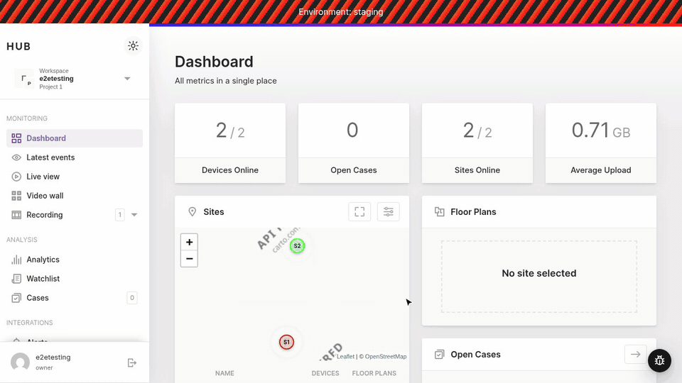

# @uug-ai/inspect

A browser library for filing bug reports from inside a web app. The user captures part of the page, marks it up, and submits; a GitHub issue is created through the [inspect server](../server).



- **Area**: drag a rectangle and take a screenshot of it.
- **Element**: hover to highlight elements and click one to screenshot it. The report includes a CSS selector for the element. `↑` and `↓` move the selection to the parent or back to the child.
- **Record**: record a video of an area or of the whole page. The page stays usable while recording.
- **Note**: send a report without a capture.

A report can hold up to five screenshots: use **+ Area** or **+ Element** under the screenshot to add another, click a thumbnail to switch, × to remove, and **Retake** to capture the selected one again. Screenshots open in an editor with arrow, rectangle, pen and text tools, plus **pixelate** for hiding faces, number plates and personal data before anything is uploaded. Clicking **Create issue** closes the dialog straight away; the report is sent in the background with a progress toast, which turns into a link to the new issue. If sending fails, the dialog reopens with everything the person entered and the error. Reporters can pick **labels** and **assignees** from the target repository, as on GitHub. **Write it for me** turns a few quick words and the screenshots into a full issue (summary, steps to reproduce, expected and actual behaviour, acceptance criteria and test cases) using the server's Azure OpenAI assistant; the reporter reviews or undoes the draft before creating the issue. The button appears only when the server has it configured. Screenshots are uploaded as WebP (PNG where the browser can't encode WebP), several times smaller than PNG. Each report includes the page URL, browser, viewport, recent console errors and warnings, and any metadata your app supplies. The user sees all of this in the dialog and can opt out.

The library uses no framework and has no runtime dependencies (about 14 KB gzipped). All of its UI lives in a Shadow DOM, so its styles don't affect the host app and the host app's styles don't affect it.

## How capture works

Capture uses the browser's screen-capture API (`getDisplayMedia`), which Chromium can point at the current tab directly. The browser asks the user for permission once per session, the first time they choose Area, Element or Record. The stream is released when the report is sent or cancelled.

This records real pixels, including `<video>`, `<canvas>`, WebGL and cross-origin images. DOM-to-image libraries can't capture those, and Hub's camera views are made of them.

If the user shares a different tab, a window or a whole screen, the library can't map the selection onto the captured image, so it uses the full frame. Firefox and Safari don't offer "this tab" first, so users pick it themselves.

## Install

```sh
npm install @uug-ai/inspect
```

## Usage

```ts
import { createInspect } from '@uug-ai/inspect';

const inspect = createInspect({
  endpoint: 'https://inspect.example.com', // the inspect server
  repo: 'uug-ai/hub-frontend',              // must be on the server's allowlist
  getContext: () => ({ version: APP_VERSION, user: currentUser.id }),
});

// Optional: open it from your own UI instead of (or in addition to) the launcher.
inspect.open();          // toolbar
inspect.start('region'); // straight into a mode
inspect.destroy();       // remove everything
```

### Angular (hub-frontend)

Create it once at startup, outside the Angular zone, so the overlay's mouse-move handlers don't trigger change detection:

```ts
// app.component.ts
import { Component, NgZone, OnDestroy, OnInit } from '@angular/core';
import { createInspect, type Inspect } from '@uug-ai/inspect';
import { environment } from '../environments/environment';

@Component({ /* … */ })
export class AppComponent implements OnInit, OnDestroy {
  private inspect?: Inspect;
  constructor(private zone: NgZone) {}

  ngOnInit() {
    if (!environment.inspectEndpoint) return; // e.g. only on staging / for internal users
    this.inspect = this.zone.runOutsideAngular(() =>
      createInspect({
        endpoint: environment.inspectEndpoint,
        repo: 'uug-ai/hub-frontend',
        getContext: () => ({ version: environment.version }),
      }),
    );
  }

  ngOnDestroy() {
    this.inspect?.destroy();
  }
}
```

### Script tag

```html
<script src="https://unpkg.com/@uug-ai/inspect/dist/inspect.umd.cjs"></script>
<script>
  UugInspect.createInspect({ endpoint: 'https://inspect.example.com' });
</script>
```

## Options

| Option | Default | Description |
|---|---|---|
| `endpoint` | — | Base URL of the inspect server. Reports go to `POST {endpoint}/v1/issues`. |
| `repo` | server default | Target `owner/name`. The server rejects repos that aren't on its allowlist. |
| `labels` | — | Labels to request. The server keeps only those on its allowlist. |
| `headers` | — | `() => headers` sent with every submit, e.g. `Authorization: Bearer …`. |
| `getContext` | — | `() => object` of app metadata to include (version, user, tenant…). Non-string values are JSON-encoded. |
| `onSubmit` | — | `(report) => Promise<{ number?, url? }>`. Replaces the built-in HTTP submit, for example to route reports through your own API. |
| `onAssist` | server's assistant | `(request) => Promise<{ title, description }>` to draft with your own service, or `false` to hide **Write it for me**. By default the button appears when the inspect server has Azure OpenAI configured. |
| `onOptions` | server's repo | `() => Promise<{ labels, assignees }>` to supply the Labels and Assignees pickers yourself, or `false` to hide them. By default they list the target repository's labels and assignable users from the inspect server. |
| `launcher` | `true` | Shows the floating button. Pass `false` to hide it, or `{ position: 'bottom-left' }` to move it. |
| `shortcut` | `'alt+shift+i'` | Toggles the toolbar. Pass `false` to disable. |
| `captureConsole` | `true` | Keeps the last 50 console errors and warnings, uncaught errors and unhandled rejections. |
| `maxRecordingSeconds` | `120` | Recordings stop automatically after this many seconds. |
| `accentColor` | `#6d4aff` | Colour used for buttons and highlights. |
| `zIndex` | `2147483000` | z-index of the overlay. |

## Keyboard

| Key | Where | Action |
|---|---|---|
| `Alt+Shift+I` | anywhere | Open or close the toolbar |
| `Enter` | area / record selection | Select the whole page |
| `↑` / `↓` | element picker | Select the parent / go back to the child |
| `A` `R` `P` `T` `B` | screenshot editor | Arrow, rectangle, pen, text, pixelate |
| `Ctrl/⌘+Z` | screenshot editor | Undo |
| `Ctrl/⌘+Enter` | report dialog | Submit |
| `Esc` | anywhere | Cancel or close; stops a recording |

## Development

```sh
npm install
npm run dev     # demo app on http://localhost:5180 with a mock submit
npm run build   # dist/ (ESM + UMD + .d.ts)
```

Open `http://localhost:5180/?endpoint=http://localhost:8080` to send reports to a local server running in dry-run mode (see [server/README.md](../server/README.md)).
